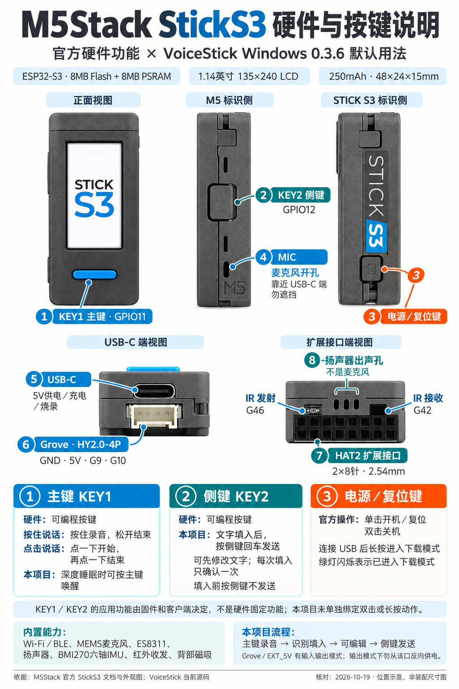

# M5Stack StickS3 硬件、按键与接口说明

核对日期：2026-10-19。设备型号为 StickS3，SKU K150；应用用法对应本仓库 Windows 0.3.6 默认开启的“按侧键确认发送”。

Windows 0.4.0 与配套固件新增自定义手势，默认改为主键单击确认发送、长按录音，侧键单击撤销、双击重做、长按粘贴；详见 [自定义按键使用说明](自定义按键使用说明.md)。下图和旧版本按键用法用于硬件位置辨认，实际动作以客户端配置为准。

硬件规格和位置依据 [M5Stack 官方中文文档](https://docs.m5stack.com/zh_CN/core/StickS3)、[官方标注外观图](https://m5stack-doc.oss-cn-shenzhen.aliyuncs.com/1207/K150-stickS3_main-products_01.webp)与[官方原理图](https://m5stack-doc.oss-cn-shenzhen.aliyuncs.com/1207/K150_Stick_S3_PRJ_V0.6_20251111_2025_11_17_16_10_24.pdf)。应用行为另按项目源码核对，不代表其他固件的默认设置。

本目录另保留一张 [M5Stack 外观标注参考图](assets/32dadb51f0f4509dd82c1c6b0f1f0698.jpg)，用于对照 KEY1、KEY2、麦克风和接口位置；原图中的硬件标注不决定客户端手势功能。

## 三个按键，分别负责什么

| 按键 | 如何辨认 | 硬件连接 | 官方硬件用途 | 本项目用法 |
| --- | --- | --- | --- | --- |
| KEY1 主键 | 屏幕下方的蓝色长条键 | ESP32-S3 GPIO11 | 可编程输入；按法由固件定义 | 按住说话模式：按住录音、松开结束；点击说话模式：单击开始、再单击结束。深度睡眠时按主键可唤醒。 |
| KEY2 侧键 | 带 M5 标识的一侧，中部较大的矩形键 | ESP32-S3 GPIO12 | 可编程输入；不是系统电源键 | 文字填入目标输入框后，按一下向原窗口发送回车；可先编辑再确认。每次填入仅确认一次，填入前按侧键不发送。 |
| 电源／复位键 | 带 STICK S3 字样的一侧，靠近 USB-C 端的小按键 | 电源管理路径，由 M5PM1 处理 | 单击开机／复位；双击关机；连接 USB 后长按进入下载模式，内部绿灯闪烁表示进入成功 | 沿用系统级电源／下载操作，不用于回车发送。 |

**KEY2 与电源／复位键位于相对的两个侧面。** 可以按壳上的 “M5” 和 “STICK S3” 字样辨认，避免因手持方向改变而混淆左右。

官方没有为 KEY1、KEY2 规定通用的“单击＝某功能、双击＝某功能”。在本项目中，两者没有独立的双击手势；KEY2 长按后的松开仍只处理为一次侧键操作，不会触发另一个长按功能。不要把电源键的双击关机套用到 KEY2。

Windows 侧键模式的具体边界：

- 成功填入后立即收起悬浮窗，不显示每次输入完成提示。
- 只有刚完成输入的同一设备可以确认发送；其他设备的侧键不会替它发送。
- 开始下一次录音、设备断开、恢复上次输入或修改设置会清除上次待发送状态。
- 若切换到其他窗口，会提示回到原输入窗口再确认；检查粒度是顶层窗口，同一窗口内仍要保持目标输入框获得焦点。
- 目标应用须以回车作为发送键。托盘菜单和设置可关闭侧键模式，恢复原取消／恢复交互；字幕模式另按原有逻辑处理。
- 默认按住说话模式中，短于 0.5 秒的录音会被丢弃；不是每次轻点都会产生识别结果。

源码依据：[按键 GPIO 定义](../firmware/components/stick_s3_board/include/stick_s3_board.h)、[固件按键与睡眠流程](../firmware/main/main.c)、[Windows 交互状态机](../desktop/windows/src/voice_stick_coordinator.cc)、[回车与窗口检查](../desktop/windows/src/input_injector_win.cc)。

## 麦克风在哪，声音从哪里进出

**MIC 麦克风开孔位于带 M5 标识的一侧、靠近 USB-C 端的竖向小开孔。** 以官方外观图的 `MIC` 箭头为准，握持时尽量不遮挡此处。图中的其他结构卡扣槽不是额外的麦克风。

另一端、HAT2 扩展口上方的三条竖孔是**扬声器出声孔**，不是麦克风；旁边的红外窗口也不是拾音口。[位置依据：官方外观图](https://m5stack-doc.oss-cn-shenzhen.aliyuncs.com/1207/K150-stickS3_main-products_01.webp)。

内置 MEMS 麦克风的模拟信号进入 ES8311，再经 I2S 与 ESP32-S3 通信；扬声器输出经 AW8737 功放。外部可见的 USB-C 和 Grove 接口不是 3.5mm 耳麦插孔。当前 VoiceStick 使用机内麦克风，通过 BLE 向电脑发送录音；把 USB 插到电脑，并不意味着本固件会自动成为通用 USB 麦克风。

内部音频引脚按 **ESP32-S3 视角**说明如下，避免与编解码器视角的 DIN/DOUT 相反：

| 信号 | GPIO | 含义 |
| --- | --- | --- |
| MCLK | G18 | 音频主时钟 |
| BCLK | G17 | I2S 位时钟 |
| LRCK | G15 | I2S 帧／左右声道时钟 |
| MCU 输出 → ES8311 DIN | G14 | 扬声器音频数据方向 |
| ES8311 DOUT → MCU 输入 | G16 | 麦克风采样数据方向 |
| I2C SCL / SDA | G48 / G47 | ES8311 配置总线；与板载其他器件共用 |

ES8311 的 I2C 地址为 `0x18`。当前项目按 16kHz、16bit、单声道采集并编码 Opus；这是项目配置，不是硬件唯一支持的音频格式。连接方向依据官方原理图及项目引脚定义。

## 外部接口

### USB-C：供电、充电、烧录与调试

USB-C 位于靠近蓝色主键的短边，使用 DC 5V。原生 USB 信号为 G19（D−）、G20（D+）；刷机或串口调试需要支持数据传输的 USB 线。进入下载模式使用的是侧面的电源／复位键，而不是 KEY2。[依据：官方原理图](https://m5stack-doc.oss-cn-shenzhen.aliyuncs.com/1207/K150_Stick_S3_PRJ_V0.6_20251111_2025_11_17_16_10_24.pdf)。

### Grove：白色 HY2.0-4P 口

白色四针接口与 USB-C 位于同一端，名称为 PORT.A／PORT.CUSTOM。按官方线色定义：

| 线色 | 信号 |
| --- | --- |
| 黑 | GND |
| 红 | 5V／EXT_5V |
| 黄 | GPIO9 |
| 白 | GPIO10 |

G9、G10 是可编程信号脚，具体使用 I2C、UART 或其他功能由程序设置，不是固定耳机或麦克风接口。GPIO 与 5V 电源脚是不同用途，不能把 5V 当作 GPIO 电平使用。[依据：官方管脚映射](https://docs.m5stack.com/zh_CN/core/StickS3)。

### HAT2：另一端的 2×8 扩展排母

HAT2 位于与 USB-C 相对的短边，间距 2.54mm，共 16 针。下表保留官方 `PIN / LEFT / RIGHT / PIN` 的编号约定；它是逻辑引脚表，**不是任意翻转后的插头正视方向图**，接线时同时核对背面丝印。

| 左侧编号 | 左侧信号 | 右侧信号 | 右侧编号 |
| --- | --- | --- | --- |
| 1 | GND | G5 | 2 |
| 3 | EXT_5V | G4 | 4 |
| 5 | Boot / G0 | G6 | 6 |
| 7 | G1 | G7 | 8 |
| 9 | G8 | G43 | 10 |
| 11 | BAT | G44 | 12 |
| 13 | 3V3_L2 | G2 | 14 |
| 15 | 5V_IN | G3 | 16 |

`BAT` 为电池电源相关引脚，不是固定 5V；`3V3_L2` 为受电源状态控制的电源轨；`G0 / Boot` 与启动有关。旧款 Stick 的部分 HAT 在机械结构上不兼容，不能仅凭针距相同判断适配。

EXT_5V／Grove 电源口支持输入、输出模式切换。官方提示：切换为输出模式时，不要从 Grove／EXT_5V 输出口反向输入电源；此时输入供电应使用 USB 或 HAT2 的 `5V_IN`。[依据：官方供电注意事项与 HAT2 表](https://docs.m5stack.com/zh_CN/core/StickS3)。

### 红外与扬声器

扩展端有红外发射（G46）、红外接收（G42）及三条扬声器出声孔。它们是硬件能力，当前语音输入项目没有提供通用红外遥控功能。官方特别说明红外接收需要 RMT，并要求关闭扬声器功放后使用。[依据：官方红外说明](https://docs.m5stack.com/zh_CN/core/StickS3)。

## 其他硬件能力

StickS3 内置 ESP32-S3-PICO-1-N8R8、8MB Flash、8MB PSRAM、1.14 英寸 135×240 LCD、BMI270 六轴 IMU、250mAh 电池，背面支持磁吸。Wi-Fi、BLE、音频、运动检测和红外等能力需要相应固件支持，不等于 VoiceStick 已全部启用。[依据：官方规格](https://docs.m5stack.com/zh_CN/core/StickS3)。

## 说明图来源与制图记录

图像使用内置 imagegen 生成；以官方产品图核对正面、M5 侧、STICK S3 侧、USB-C 端和 HAT2 端。它是位置说明图，不作为装配尺寸图；工程尺寸请以官方模型图为准。最终提示词保存在 [StickS3说明图提示词](assets/StickS3说明图提示词.txt)。

- [官方标注外观图](https://m5stack-doc.oss-cn-shenzhen.aliyuncs.com/1207/K150-stickS3_main-products_01.webp)
- [M5 标识侧实拍](https://m5stack-doc.oss-cn-shenzhen.aliyuncs.com/1207/K150-stickS3_main-products_10.webp)
- [STICK S3 标识侧实拍](https://m5stack-doc.oss-cn-shenzhen.aliyuncs.com/1207/K150-stickS3_main-products_11.webp)
- [USB-C 端实拍](https://m5stack-doc.oss-cn-shenzhen.aliyuncs.com/1207/K150-stickS3_main-products_09.webp)
- [HAT2 端实拍](https://m5stack-doc.oss-cn-shenzhen.aliyuncs.com/1207/K150-stickS3_main-products_12.webp)
- [官方尺寸图](https://m5stack-doc.oss-cn-shenzhen.aliyuncs.com/1207/K150-sticks3_page_01.png)
